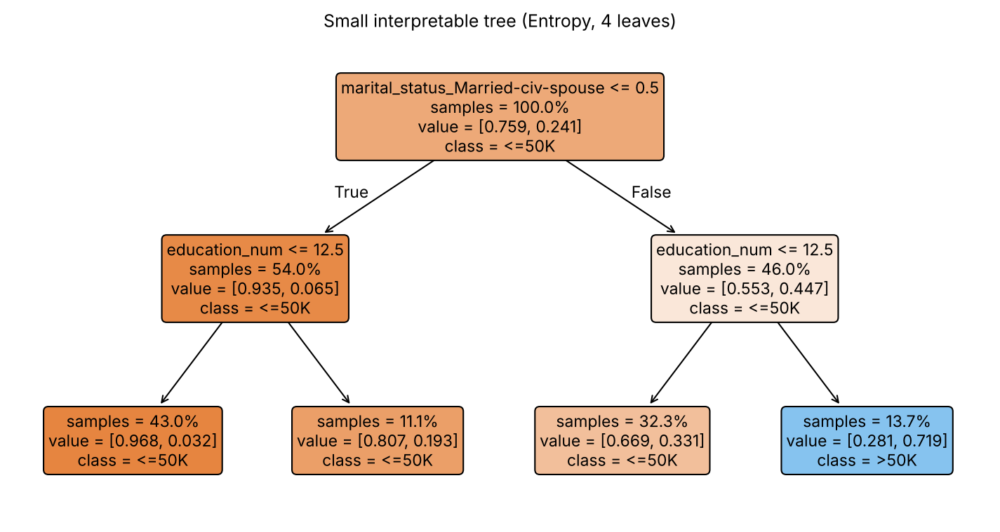
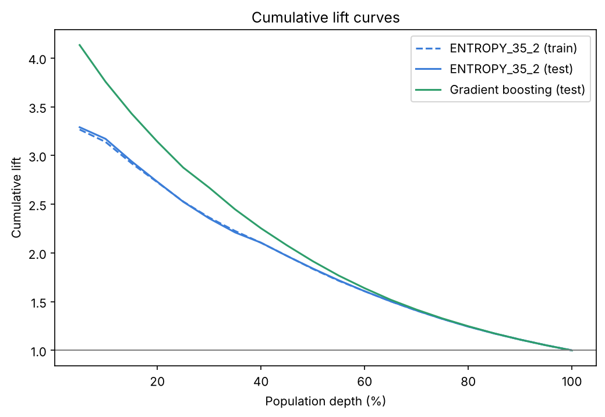
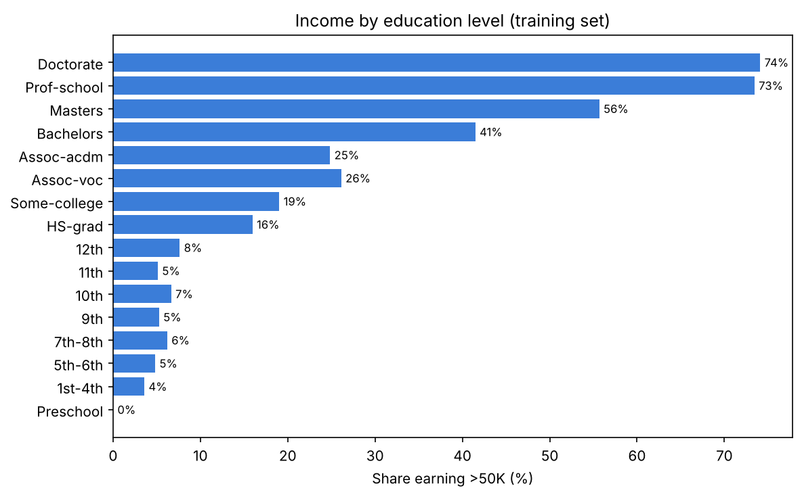
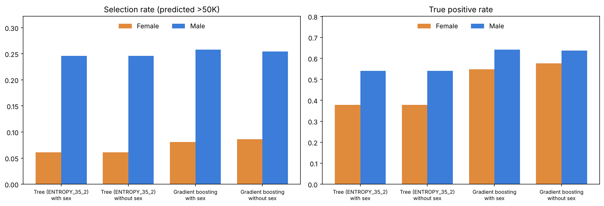

# Adult Income: Reproducible Machine Learning Analysis in Python

[](https://colab.research.google.com/github/Omar-Arif-Projects/adult-income-ml-python/blob/main/income_analysis.ipynb)

A Python reimplementation of an income-classification workflow originally built in SAS Viya Model Studio, with an independent evaluation on the official test set, a fairness analysis, and a comparison against the SAS results.

The original SAS Viya project (decision trees and k-means on the same dataset) is documented here: [adult-income-data-mining](https://github.com/Omar-Arif-Projects/adult-income-data-mining).

## Goals

1. **Reproduce** the workflow (cleaning, imputation, decision trees, clustering) with open-source tools that anyone can run.
2. **Evaluate independently**, on the dataset's official held-out test set instead of a random split.
3. **Analyze fairness**, measuring how the models behave across sex and race groups.
4. **Compare** the Python results with the SAS Viya results and explain any differences.

## Dataset

[UCI Adult Census Income](https://archive.ics.uci.edu/dataset/2/adult): 32,561 training rows and 16,281 test rows, 14 input variables, and a binary target (`income`: `<=50K` or `>50K`). The notebook downloads the two official files from the UCI repository and caches them in `data/`, so no raw data is stored in this repository. If the automatic download fails, download the dataset from the link above and place `adult.data` and `adult.test` in a `data/` folder next to the notebook.

## Approach

| Step | Method |
|---|---|
| Cleaning | Treat `?` as missing, strip whitespace, standardize labels, drop `native_country` (as in SAS) |
| Preprocessing | Values beyond 3 standard deviations set to missing, then median imputation (numeric) and most-frequent imputation (categorical), one-hot encoding |
| Trees | Entropy and Gini, minimum leaf size 6% or 3.5% of the data, depth up to 10, pruning strength chosen by 5-fold cross-validation on the training set |
| Reference models | Majority-class baseline, logistic regression, gradient boosting (untuned) |
| Clustering | k-means with 2 to 5 clusters, on numeric variables only and on all inputs |
| Evaluation | Accuracy, precision, recall, F1, ROC AUC and lift on the official test set, scored once after tuning |
| Fairness | Selection rate, true and false positive rates, demographic parity and equalized odds differences by sex and race, with and without the sex input |

One random seed (12345, the same as in the SAS project) is used throughout.

## Results

### Model performance (official test set)

| Model | Test accuracy | ROC AUC |
|---|---|---|
| Majority-class baseline | 0.764 | 0.500 |
| Decision tree, Entropy, 4 leaves | 0.822 | n/a |
| Decision tree `ENTROPY_35_2` (selected by cross-validation, 23 leaves) | 0.823 | 0.867 |
| Logistic regression | 0.845 | 0.897 |
| Gradient boosting | 0.861 | 0.915 |

A tree small enough to read in one picture gives up two to four percentage points of accuracy against the stronger models.



The selected tree is stable: its lift curve on the training data and on the test data is almost identical.





### Comparison with SAS Viya

Trees grown to the same number of leaves as the SAS trees (same criterion and minimum leaf size):

| Tree | SAS accuracy | Python accuracy | Leaves |
|---|---|---|---|
| ENTROPY_6_2 | 0.82 | 0.822 | 4 |
| GINI_6_2 | 0.82 | 0.822 | 4 |
| ENTROPY_35_2 | 0.83 | 0.822 | 8 |
| GINI_35_2 | 0.83 | 0.820 | 8 |

- **Accuracy agrees to within about one percentage point.** Left to prune itself, scikit-learn keeps more leaves (8 to 23) than SAS did (4 to 8) for essentially the same accuracy.
- **Lift does not reproduce.** The SAS lift values (1.16 to 1.38) are well below every Python value under either common definition, even at the same tree size. The SAS export does not record how they were computed, so lift is left out of the comparison above.
- **Clustering on all inputs matches the SAS two-cluster split closely** (16,828 / 15,733 against 16,930 / 15,631) and isolates a small cluster of about 1,250 people at 4 and 5 clusters, as SAS did. The three-cluster solutions differ, which is typical of k-means local optima. Silhouette scores are low (about 0.11 to 0.12), so the segments overlap heavily.

Differences come from the tools themselves: the data partitions differ, and so do the pruning, missing-value and tie handling. scikit-learn trees only split in two (no 4-branch trees), and CHAID and information gain ratio are not built in, so those SAS trees have no Python equivalent here.

### Fairness

Full details are in [`fairness_report.md`](fairness_report.md).

- In the test data 30.0% of men and 10.9% of women earn more than $50K.
- The selected tree predicts >$50K for 24.6% of men and 6.1% of women: men are flagged about four times as often, against about 2.75 times in the data. Its true positive rate is 0.54 for men and 0.38 for women, so high-earning women are missed more often.
- Removing the `sex` input changed none of the tree's predictions and narrowed gradient boosting's gap only slightly, because other variables can act as proxies.



## Repository structure

```
.
├── README.md
├── LICENSE
├── requirements.txt
├── income_analysis.ipynb    (full workflow with outputs)
├── fairness_report.md
└── figures/
```

## How to run

**In Google Colab:** open the notebook with the badge at the top of this page and choose **Runtime → Run all**. The notebook installs `fairlearn` if it is missing and downloads the data itself.

**Locally:**

```bash
git clone https://github.com/Omar-Arif-Projects/adult-income-ml-python.git
cd adult-income-ml-python
python -m venv .venv
source .venv/bin/activate        # on Windows: .venv\Scripts\activate
pip install -r requirements.txt
jupyter notebook income_analysis.ipynb
```

The results in this README were produced with Python 3.13 and the library versions listed in `requirements.txt`. Other versions, including those preinstalled in Colab, may differ in later decimal places.

## Limitations

- The data is a 1994 US census extract. Sex is recorded as binary and race in broad categories, so the results describe patterns in this dataset and not the people it represents. A model like this should not be used for real decisions about individuals.
- No bias mitigation was attempted: the analysis measures gaps and does not fix them.
- The SAS comparison is a cross-check and not an exact replication.

## Data citation

Becker, B. and Kohavi, R. (1996). *Adult*. UCI Machine Learning Repository. https://archive.ics.uci.edu/dataset/2/adult

## License

The code is released under the [MIT License](LICENSE). The dataset is distributed by the UCI Machine Learning Repository under its own terms, which are listed on the dataset page.

## Author

[Omar Arif](https://github.com/Omar-Arif-Projects)
