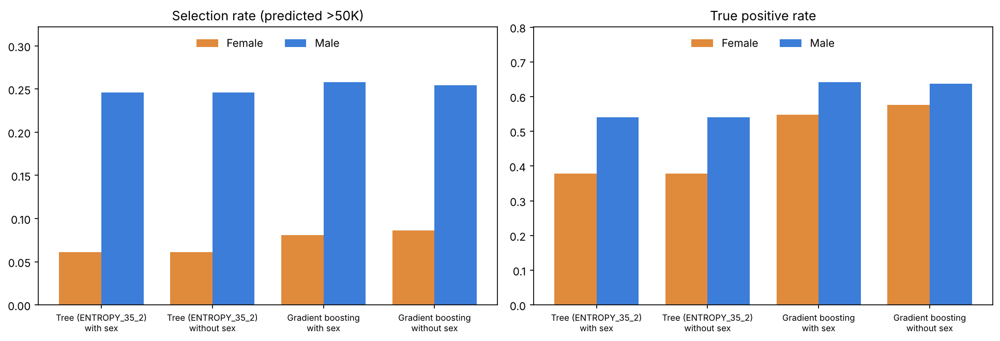

# Fairness Report

This report summarizes the fairness analysis in [`income_analysis.ipynb`](income_analysis.ipynb) (section 8). All numbers are computed on the official UCI test set (16,281 rows) with models trained on the official training set.

## What was checked

Two models were evaluated, each trained **with** and **without** the `sex` input:

- the decision tree selected by cross-validation (`ENTROPY_35_2`, 23 leaves), and
- gradient boosting with default settings.

Metrics, by group:

| Metric | Meaning |
|---|---|
| Selection rate | Share of the group predicted to earn more than $50K |
| True positive rate (TPR) | Among people who really earn more than $50K, the share predicted to |
| False positive rate (FPR) | Among people who earn $50K or less, the share predicted to earn more |
| Demographic parity difference | Largest gap in selection rate between groups |
| Equalized odds difference | Larger of the largest TPR gap and the largest FPR gap between groups |

## The data itself

| Group (test set) | Rows | Share earning >$50K |
|---|---|---|
| Male | 10,860 | 30.0% |
| Female | 5,421 | 10.9% |

Men are about 2.75 times as likely as women to be in the high-income class in this data, before any model is involved.

## Results by sex

| Model | Female selection rate | Male selection rate | Female TPR | Male TPR | Female FPR | Male FPR |
|---|---|---|---|---|---|---|
| Tree, with sex | 0.061 | 0.246 | 0.378 | 0.540 | 0.022 | 0.120 |
| Tree, without sex | 0.061 | 0.246 | 0.378 | 0.540 | 0.022 | 0.120 |
| Gradient boosting, with sex | 0.081 | 0.258 | 0.547 | 0.641 | 0.024 | 0.094 |
| Gradient boosting, without sex | 0.086 | 0.254 | 0.576 | 0.638 | 0.026 | 0.090 |

| Model | Demographic parity difference | Equalized odds difference |
|---|---|---|
| Tree, with sex | 0.185 | 0.162 |
| Tree, without sex | 0.185 | 0.162 |
| Gradient boosting, with sex | 0.177 | 0.094 |
| Gradient boosting, without sex | 0.168 | 0.064 |

## Results by race

| Model | Demographic parity difference | Equalized odds difference |
|---|---|---|
| Tree (with or without sex) | 0.229 | 0.459 |
| Gradient boosting, with sex | 0.208 | 0.308 |
| Gradient boosting, without sex | 0.202 | 0.293 |

Some race groups are small in the test set (Other: 135 rows, Amer-Indian-Eskimo: 159 rows), so these differences are noisy and the equalized odds figures in particular should be read with caution. Group sizes and actual high-income rates for every race group are printed in the notebook.

## What this shows

1. **The model reproduces the gap in the data, and in relative terms widens it.** The tree flags men about four times as often as women, against about 2.75 times in the underlying data. In absolute terms the gap is similar (18.5 points against 19.1).
2. **High-earning women are missed more often.** The tree's true positive rate is 0.54 for men and 0.38 for women. Gradient boosting narrows this to 0.64 against 0.55.
3. **Removing `sex` did not fix it.** The tree split on `sex` in places, but those splits never changed a prediction, so its predictions were identical without it (100% of test rows). For gradient boosting, removing `sex` narrowed the demographic parity difference only from 0.177 to 0.168. Other variables, such as `relationship` and `marital_status`, can act as proxies for sex, although this analysis did not test which ones do.
4. **Accuracy hides the gap.** Accuracy is higher for women than for men (for the tree, 0.91 against 0.78) because most women fall in the lower-income class. A single overall accuracy figure says nothing about who the errors fall on.

## What this does not show

- The data is a 1994 US census extract, with sex recorded as binary and race in broad categories. The results describe patterns in this dataset and not the people it represents.
- Only prediction gaps were measured. No mitigation (reweighting, threshold adjustment, constrained training) was attempted, so nothing here says what would reduce them or at what cost in accuracy.
- Differences between groups come from several sources (the data, the features, the labels, the model), and these metrics cannot separate them.
- A model like this should not be used to make real decisions about individuals.
